<div align="center">

# 🌍 Horizon Travel — Native Android Client

[](https://developer.android.com)
[](https://www.oracle.com/java/)
[-007ACC?style=for-the-badge&logo=android)](https://developer.android.com/about/dashboards)
[](https://developer.android.com)
[](https://gradle.org)
[](https://square.github.io/retrofit/)
[]()
[](https://m3.material.io/)

<p align="center">
  <b>"Your Gateway to Endless Journeys"</b><br>
  An enterprise-grade, full-stack travel booking, tour management, and logistics Android application.<br>
  Seamlessly unites <b>Tourists</b>, <b>Tour Guides</b>, <b>Service Providers</b>, and <b>Platform Administrators</b> within a single hardened native APK.
</p>

[✨ Key Features](#-key-features-by-role) • [📱 Real UI Showcase](#-real-ui-screenshots--demo-walkthrough) • [🏛️ Architecture](#%EF%B8%8F-architecture--engineering-highlights) • [🛠️ Tech Stack](#%EF%B8%8F-tech-stack--dependencies) • [🚀 Quick Start](#-quick-start--setup-guide) • [👥 Test Accounts](#-pre-seeded-demo-accounts)

---

</div>

## 📑 Table of Contents
- [Executive Overview](#-executive-overview)
- [Real UI Screenshots & Demo Walkthrough](#-real-ui-screenshots--demo-walkthrough)
  - [1. Tourist & Discovery Experience](#1-tourist--discovery-experience)
  - [2. Tour Guide & Administration Portals](#2-tour-guide--administration-portals)
- [Key Features by Role](#-key-features-by-role)
  - [🧭 Tourist Experience](#-tourist-experience)
  - [🎒 Tour Guide Experience](#-tour-guide-experience)
  - [🏨 Service Provider Experience](#-service-provider-experience)
  - [🛡️ Administrator Experience](#%EF%B8%8F-administrator-experience)
- [Architecture & Engineering Highlights](#%EF%B8%8F-architecture--engineering-highlights)
  - [Single-APK Multi-Role RBAC Routing](#single-apk-multi-role-rbac-routing)
  - [Strict 100% ViewBinding (Zero findViewById)](#strict-100-viewbinding-zero-findviewbyid)
  - [Zero-Leak Lifecycle Guards & Background Threading](#zero-leak-lifecycle-guards--background-threading)
  - [Token Lifecycle & Global 401 Interceptor](#token-lifecycle--global-401-interceptor)
  - [Enterprise Security & Android Backup Protection](#enterprise-security--android-backup-protection)
- [Tech Stack & Dependencies](#%EF%B8%8F-tech-stack--dependencies)
- [Repository & Package Structure](#-repository--package-structure)
- [Backend Integration & Endpoints](#-backend-integration--endpoints)
- [Quick Start & Setup Guide](#-quick-start--setup-guide)
  - [Prerequisites](#prerequisites)
  - [1. Backend Deployment](#1-backend-deployment)
  - [2. BASE_URL Configuration](#2-base_url-configuration)
  - [3. Build & Run via Gradle / Android Studio](#3-build--run-via-gradle--android-studio)
- [Pre-Seeded Demo Accounts](#-pre-seeded-demo-accounts)
- [Build & Verification Commands](#-build--verification-commands)
- [Roadmap & Enhancements](#-roadmap--enhancements)
- [License](#-license)

---

## 🌟 Executive Overview

**Horizon Travel** is a comprehensive, production-ready native Android client crafted in modern Java 11. It delivers an end-to-end travel marketplace designed for seamless scalability, rock-solid stability, and zero runtime crashes.

Unlike traditional travel apps that silo users into separate applications, Horizon Travel implements a **dynamic single-APK, multi-role architecture** with defense-in-depth Role-Based Access Control (RBAC). Upon authentication, users are dynamically routed into dedicated role shells:

```
                                  ┌─────────────────────────────┐
                                  │      Splash / Login         │
                                  └──────────────┬──────────────┘
                                                 │
                                           [RoleRouter]
                                                 │
            ┌────────────────────┬───────────────┴───────────────┬────────────────────┐
            ▼                    ▼                               ▼                    ▼
   ┌─────────────────┐  ┌─────────────────┐             ┌─────────────────┐  ┌─────────────────┐
   │  TOURIST SHELL  │  │TOUR GUIDE SHELL │             │ PROVIDER SHELL  │  │   ADMIN SHELL   │
   │  • Explore & Buy│  │• Availability   │             │• Slot Inventory │  │• KYC Review     │
   │  • Guide Booking│  │• Tour Requests  │             │• Booking Mgmt   │  │• User Directory │
   │  • Live GPS Map │  │• Live GPS Cast  │             │• Revenue Ledger │  │• Finance Audit  │
   │  • AI Concierge │  │• Reviews & Bio  │             │• Business KYC   │  │• BI Analytics   │
   └─────────────────┘  └─────────────────┘             └─────────────────┘  └─────────────────┘
```

Every screen is crafted using **Google Material Design 3**, responsive XML layouts with fluid edge-to-edge window insets, custom vector iconography, and strict ViewBinding across all 40+ Activities and Fragments.

---

## 📱 Real UI Screenshots & Demo Walkthrough

The application has been thoroughly tested across physical Android devices and high-density emulators. Below is a visual walkthrough of the key flows:

### 1. Tourist & Discovery Experience

<table>
  <tr>
    <td align="center" width="25%">
      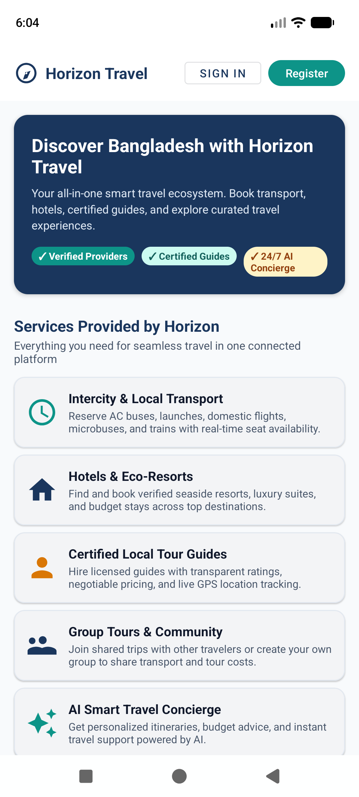<br>
      <b>Public Home & Landing</b><br>
      <i>Hero banner, quick categories, and curated travel services.</i>
    </td>
    <td align="center" width="25%">
      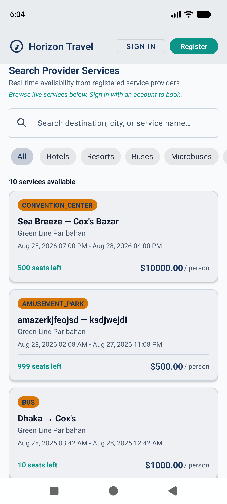<br>
      <b>Live Search & Filter Chips</b><br>
      <i>Interactive search bar with dynamic service category chips.</i>
    </td>
    <td align="center" width="25%">
      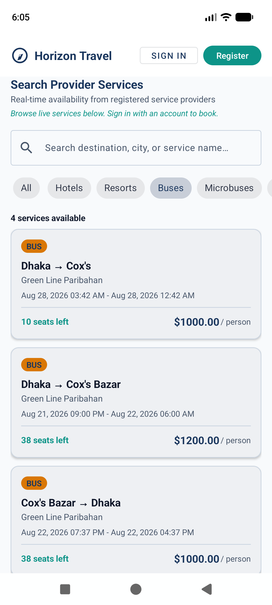<br>
      <b>Filtered: Inter-City Buses</b><br>
      <i>Filtered by transport type showing operator schedules and fares.</i>
    </td>
    <td align="center" width="25%">
      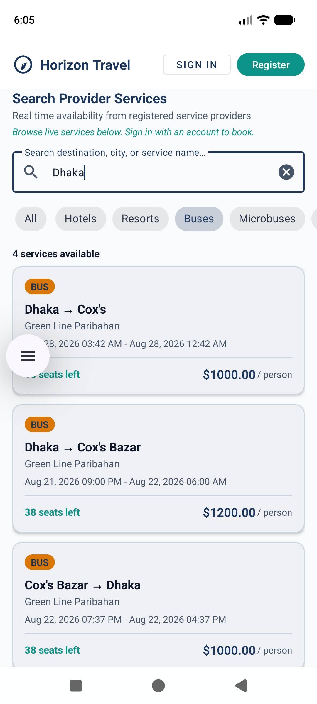<br>
      <b>Real-Time Keyword Search</b><br>
      <i>Instant debounce search filtering by destination ("Dhaka").</i>
    </td>
  </tr>
  <tr>
    <td align="center" width="25%">
      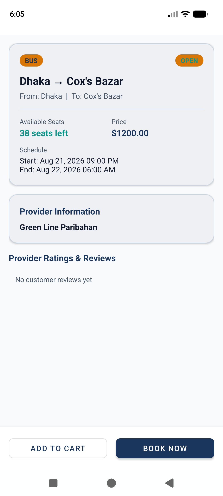<br>
      <b>Service Slot Details</b><br>
      <i>Operator information, schedule, seat count, and direct booking actions.</i>
    </td>
    <td align="center" width="25%">
      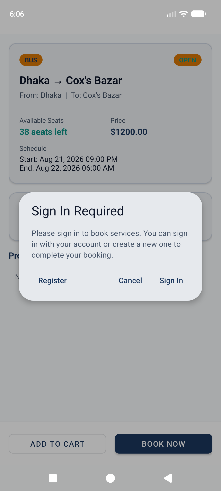<br>
      <b>Guest Access Guard</b><br>
      <i>Sign-in modal prompted when a guest attempts booking or checkout.</i>
    </td>
    <td align="center" width="25%">
      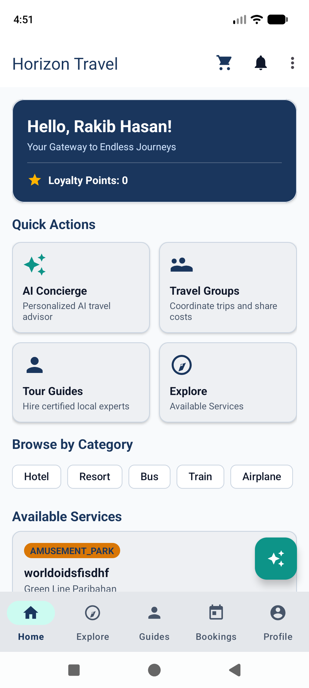<br>
      <b>AI Travel Concierge FAB</b><br>
      <i>Floating interactive AI concierge for 24/7 recommendations and trip planning.</i>
    </td>
    <td align="center" width="25%">
      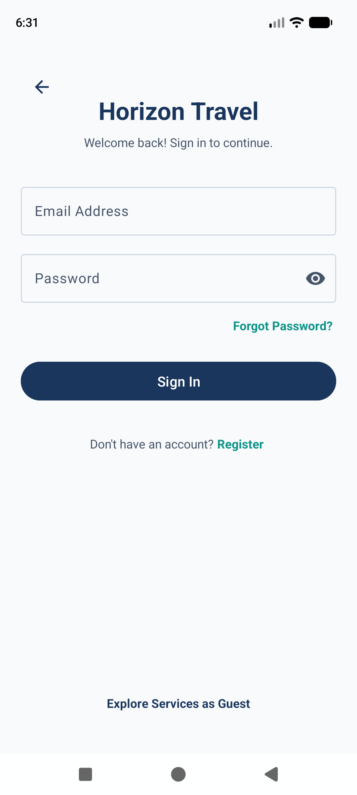<br>
      <b>Material 3 Sign-In</b><br>
      <i>Secured authentication with direct "Explore as Guest" option.</i>
    </td>
  </tr>
</table>

### 2. Tour Guide & Administration Portals

<table>
  <tr>
    <td align="center" width="25%">
      <br>
      <b>Guide Portal Dashboard</b><br>
      <i>Real-time booking requests, status toggles, and live GPS broadcaster.</i>
    </td>
    <td align="center" width="25%">
      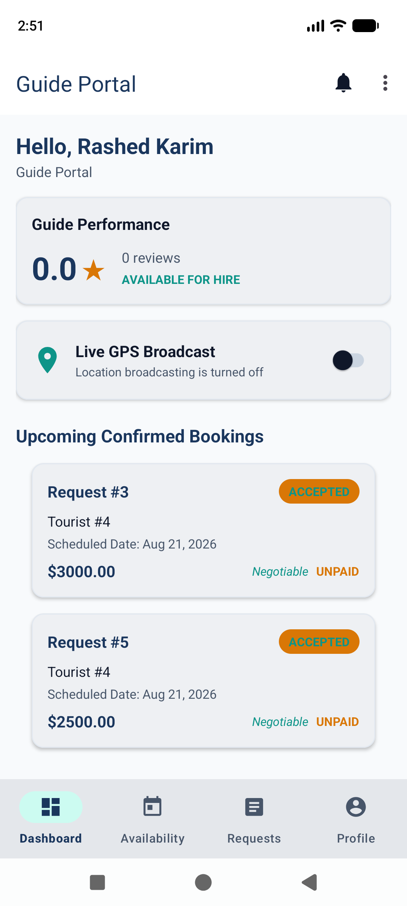<br>
      <b>Guide Profile & Reviews</b><br>
      <i>Verified credentials, language specialties, daily rate, and client ratings.</i>
    </td>
    <td align="center" width="25%">
      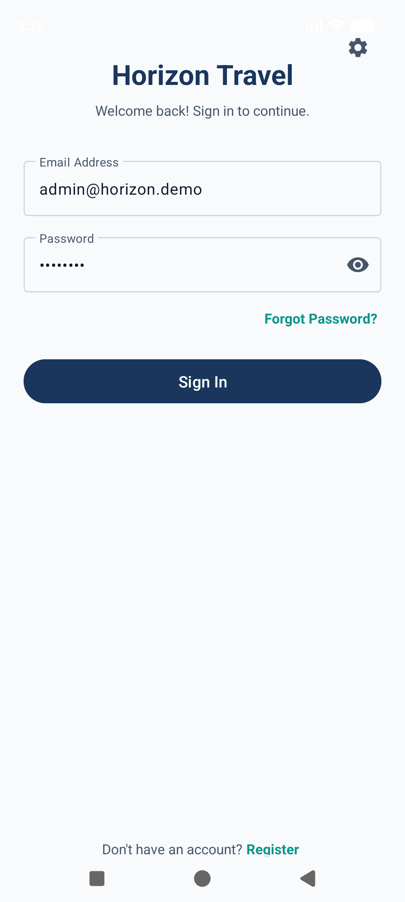<br>
      <b>Admin KYC Verification</b><br>
      <i>Review and approve/reject Guide and Service Provider credentials.</i>
    </td>
    <td align="center" width="25%">
      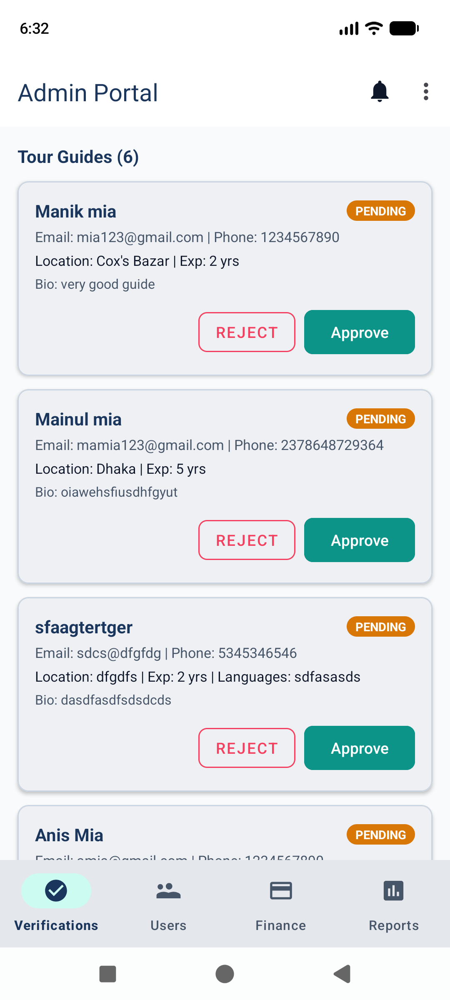<br>
      <b>Admin Operations Portal</b><br>
      <i>Comprehensive access management, financial audit, and system metrics.</i>
    </td>
  </tr>
</table>

---

## 🎯 Key Features by Role

### 🧭 Tourist Experience
- **Guest Browsing**: Explore destinations, transport schedules, and tour packages without upfront registration.
- **Dynamic Search & Filtering**: Multi-criteria search by keyword, origin, destination, date, and price range. Filter instantly using horizontal category chips (Buses, Flights, Hotels, Guides, Trains, Ferries).
- **Service Slot Details**: Deep dive into transport routes, boarding points, operator ratings, seat availability, and terms.
- **Cart & Multi-Payment Checkout**: Add multiple travel slots to a unified cart; complete checkout via Credit/Debit Cards, Mobile Banking (bKash / Nagad), or Cash on Delivery.
- **Booking Management & Digital Invoices**: View active, completed, and cancelled bookings with full receipts, status tracking, and self-service cancellation.
- **Verified Tour Guide Directory**: Browse certified local guides, inspect verified badges, read customer reviews, check languages spoken, and review daily fees.
- **Direct Guide Booking & Live GPS Tracking**: Book personal guides for custom dates and track the assigned guide's real-time location on Google Maps using safe `geo:` URI intents.
- **Community Travel Groups & Live Chat**: Create or join public travel groups for shared tours; communicate via real-time group chat with automatic polling.
- **24/7 AI Travel Concierge**: Integrated AI travel assistant (`AiConciergeActivity`) accessible via floating action button for instant recommendations, packing checklists, and local etiquette tips.
- **Ratings & Reviews**: Submit 5-star ratings and written feedback for completed transport services and tour guides.

---

### 🎒 Tour Guide Experience
- **Professional Onboarding**: Register credentials, years of experience, spoken languages, specialties, daily pricing, and tour operator license.
- **KYC Verification Gate**: Guides remain in a secure `PENDING_VERIFICATION` holding state until approved by an administrator.
- **Availability Calendar Management**: Full CRUD operations on personal availability schedules (mark dates as available, booked, or off-duty).
- **Incoming Tour Requests**: Real-time request pipeline with Accept and Decline actions.
- **Cash Payment Reconciliation**: In-person "Mark Payment Received" action for cash transactions.
- **Live GPS Broadcaster**: Background GPS broadcast toggle (`GuideDashboardFragment`) that transmits periodic coordinate updates to the backend so tourists can navigate directly to the guide.
- **Reputation & Review Analytics**: Inspect aggregate rating metrics, client feedback history, and booking completion statistics.

---

### 🏨 Service Provider Experience
- **Business Profile & Licensing**: Register transport fleets, hotels, resorts, or tour agencies with official business trade licenses.
- **Service Slot Management**: Comprehensive CRUD interface to publish travel slots (Inter-city Buses, Domestic Flights, Hotel Rooms, Train coaches, Launch/Ferry cabins).
- **Route & Pricing Configuration**: Set departure and arrival locations, timestamps, seat capacities, fare classes, and amenity tags.
- **Customer Reservation Management**: Monitor incoming passenger bookings, confirm seat assignments, and mark services as completed upon arrival.
- **Commissions & Financial Ledger**: View breakdown of earned revenue, platform commission deductions, and pending settlement payouts.

---

### 🛡️ Administrator Experience
- **KYC Verification Queue**: Dedicated verification hub (`VerificationsFragment`) to review submitted documentation for pending Guides and Service Providers with one-tap Approve or documented Reject actions.
- **Global User Directory**: Search and filter all registered users by role (Tourist, Guide, Provider, Admin) and status (`ACTIVE`, `SUSPENDED`, `REVOKED`) with immediate account suspension capabilities.
- **Financial Oversight & Settlements**: Complete audit trail of platform payments across all payment gateways, with a dedicated interface to settle provider commissions.
- **Executive BI Analytics**: Real-time reporting cards for Revenue Summaries, Bookings Metrics, and Commission Breakdowns with custom date-range filters.

---

## 🏛️ Architecture & Engineering Highlights

```
com.example.horizontravel
 ├── data
 │    ├── api         --> Retrofit ApiService, ApiClient, AuthInterceptor, ApiCallback
 │    └── model       --> 40+ Strongly-typed POJOs & Data Transfer Objects (Gson)
 ├── ui
 │    ├── admin       --> AdminMainActivity, Verifications, Users, Finance, Reports
 │    ├── auth        --> Login, Register Chooser, Role Forms, Password Recovery
 │    ├── guide       --> GuideMainActivity, Dashboard, Availability, Requests, GPS
 │    ├── provider    --> ProviderMainActivity, Dashboard, Slot CRUD, Bookings, Ledger
 │    ├── shared      --> NotificationsActivity, ChangePasswordActivity, ContactUsActivity
 │    └── tourist     --> TouristMainActivity, Home, Explore, Cart, Checkout, Groups, AI
 └── util             --> SessionManager, RoleRouter, Formatters, Validators, Constants
```

### Single-APK Multi-Role RBAC Routing
Rather than maintaining multiple separate APKs for tourists, guides, and providers, Horizon Travel operates as a single unified binary. 
- The authentication response returns the user's role and verification status.
- `RoleRouter.shellIntentFor(Context, String role)` dispatches the user to their designated Activity shell:
  - `Constants.Role.TOURIST` $\to$ `TouristMainActivity`
  - `Constants.Role.TOUR_GUIDE` $\to$ `GuideMainActivity`
  - `Constants.Role.SERVICE_PROVIDER` $\to$ `ProviderMainActivity`
  - `Constants.Role.ADMIN` $\to$ `AdminMainActivity`
- **Defense-in-depth Guards**: Each shell Activity verifies the active session role upon initialization. If a session token is manipulated or invalid, the activity safely destroys itself and redirects to `LoginActivity`.

### Strict 100% ViewBinding (Zero findViewById)
- The entire application enforces ViewBinding across all 40+ Activities, Fragments, and custom RecyclerView ViewHolders.
- Compiles with zero instances of `findViewById`, completely eliminating `NullPointerException` risks from view lookups at runtime.

### Zero-Leak Lifecycle Guards & Background Threading
- **Safe Network Callbacks**: All asynchronous network calls implement custom `ApiCallback<T>` wrappers that verify `isFinishing()`, `isDestroyed()`, or `isSafe()` before updating UI components.
- **Handler Cleanup**: Periodic background polling loops (e.g. 5-second polling in `GroupChatActivity` and 15-second GPS broadcast in `GuideLocationActivity`) strictly register in `onResume()` and dismantle in `onPause()` / `onDestroy()`, preventing background battery drain and window leaks.
- **Zero Static Leaks**: No static Activity, Context, or View references exist anywhere in the application code.

### Token Lifecycle & Global 401 Interceptor
- `AuthInterceptor` automatically injects `Authorization: Bearer <token>` and `x-refresh-token` into outgoing HTTP requests.
- Captures new `x-access-token` headers returned by the backend to seamlessly rotate tokens without user disruption.
- Detects HTTP 401 Unauthorized responses globally, clearing session state and safely routing the user back to `LoginActivity` with an informative session expiry toast.

### Enterprise Security & Android Backup Protection
- Android backup is explicitly disabled (`android:allowBackup="false"`) with explicit `data_extraction_rules.xml` and `backup_rules.xml` policies to prevent unauthorized ADB data extraction.
- Cleartext network traffic is gated to local private networks (`10.0.2.2`, `192.168.x.x`, `10.x.x.x`) for local development via `network_security_config.xml`. Production release builds strictly require HTTPS.

---

## 🛠️ Tech Stack & Dependencies

| Layer | Technology | Details / Version |
|---|---|---|
| **Language** | Java 11 (LTS) | 100% Native Java implementation |
| **Android SDK** | Min SDK 24 / Target SDK 37 | Compatible with Android 7.0 (Nougat) through Android 15 |
| **Build System** | Gradle 8+ with Kotlin DSL | `build.gradle.kts` with Version Catalog (`libs.versions.toml`) |
| **UI & Styling** | Material Components 3 | Responsive XML, Edge-to-Edge WindowInsets, ViewBinding |
| **Networking** | Retrofit 2.11.0 + OkHttp 4.12.0 | REST client with JSON serialization and HTTP logging |
| **JSON Serialization**| Gson 2.11.0 | POJOs with `@SerializedName` and fallback fields |
| **Architecture** | Single-APK Multi-Role RBAC | Role Router, SessionManager, Lifecycle Guards |
| **Mapping** | Google Maps `geo:` Intent | Direct native navigation without proprietary API key bloat |
| **Backend Companion**| Spring Boot 3.x + PostgreSQL | REST API on port `58080` with JWT Security |

---

## 📂 Repository & Package Structure

```
HorizonTravel/
├── app/
│   ├── src/main/
│   │   ├── java/com/example/horizontravel/
│   │   │   ├── HorizonApp.java           # Application entrypoint & dependency init
│   │   │   ├── MainActivity.java         # Legacy redirect stub
│   │   │   ├── data/
│   │   │   │   ├── api/                  # ApiClient, ApiService, AuthInterceptor
│   │   │   │   └── model/                # 40+ Strongly-typed POJO entities
│   │   │   ├── ui/
│   │   │   │   ├── BaseActivity.java     # Base Activity with lifecycle utilities
│   │   │   │   ├── BaseFragment.java     # Base Fragment with lifecycle utilities
│   │   │   │   ├── SplashActivity.java   # Smart launcher & session routing
│   │   │   │   ├── admin/                # Administrator dashboard & tabs
│   │   │   │   ├── auth/                 # Login, Registration & Verification
│   │   │   │   ├── guide/                # Tour Guide portal & dashboard
│   │   │   │   ├── provider/             # Service Provider portal & inventory
│   │   │   │   ├── shared/               # Notifications, Change Password, Contact
│   │   │   │   └── tourist/              # Tourist experience (Home, Slots, Cart, etc.)
│   │   │   └── util/                     # SessionManager, RoleRouter, Formatters
│   │   ├── res/                          # Layouts, Drawables, Colors, Themes, Strings
│   │   └── AndroidManifest.xml           # Manifest with role activities & permissions
│   └── build.gradle.kts                  # App-level build script (Kotlin DSL)
├── gradle/                               # Gradle wrapper and version catalog (libs.versions.toml)
├── screenshots/                          # Real 1080x2400 high-resolution device captures
├── build.gradle.kts                      # Root Gradle build script
└── settings.gradle.kts                   # Project module settings
```

---

## 🔗 Backend Integration & Endpoints

The Android client interfaces seamlessly with the Horizon Travel Spring Boot backend (`http://localhost:58080/api`). Key REST endpoints include:

| Domain | Method | Endpoint | Description |
|---|---|---|---|
| **Authentication** | `POST` | `/api/auth/login` | Authenticate and obtain JWT access & refresh tokens |
| | `POST` | `/api/auth/register/tourist` | Register new tourist account |
| | `POST` | `/api/auth/register/guide` | Register new tour guide (pending review) |
| | `POST` | `/api/auth/register/provider` | Register new service provider (pending review) |
| | `POST` | `/api/auth/forgot-password` | Request password reset token |
| | `POST` | `/api/auth/reset-password` | Reset password via token |
| **Service Slots** | `GET` | `/api/slots` | Fetch all active service slots (supports query filters) |
| | `POST` | `/api/slots` | Create new service slot (Provider only) |
| | `PUT` | `/api/slots/{id}` | Update existing service slot |
| | `DELETE`| `/api/slots/{id}` | Cancel/delete service slot |
| **Bookings & Cart** | `POST` | `/api/bookings` | Create single or multi-slot booking |
| | `GET` | `/api/bookings/tourist/{id}`| Fetch tourist booking history |
| | `PUT` | `/api/bookings/{id}/status` | Update booking status (`CANCELLED`, `COMPLETED`) |
| **Tour Guides** | `GET` | `/api/guides` | List certified tour guides |
| | `GET` | `/api/guide-availability/guide/{id}` | Fetch guide availability calendar |
| | `POST` | `/api/guide-bookings` | Request a personalized tour guide booking |
| | `PUT` | `/api/guide-bookings/{id}/status` | Accept or decline tour booking |
| | `PUT` | `/api/guides/{id}/location` | Broadcast real-time GPS coordinates |
| **Community & AI** | `GET` | `/api/groups` | Fetch available travel community groups |
| | `POST` | `/api/groups/{id}/messages` | Post a real-time message to group chat |
| | `POST` | `/api/ai/chat` | Send conversational query to AI Concierge |
| **Administration** | `GET` | `/api/admin/pending-registrations` | Fetch pending Guide & Provider verifications |
| | `PUT` | `/api/admin/verify` | Approve or reject verification with notes |
| | `GET` | `/api/admin/users` | List and filter all platform users |
| | `GET` | `/api/admin/reports/revenue-summary` | Executive financial summary |

---

## 🚀 Quick Start & Setup Guide

### Prerequisites
- **Java Development Kit (JDK)**: JDK 17 (recommended) or JDK 11.
- **Android Studio**: Android Studio Ladybug / Koala / Iguana or later.
- **Android SDK**: Build Tools 35.0.0+, compileSdk 37, minSdk 24.
- **Database**: PostgreSQL 15+ installed and running.

---

### 1. Backend Deployment

Before launching the Android client, ensure the Spring Boot companion backend is active:

```bash
# 1. Navigate to the backend directory
cd ../HorizonSpringBackend

# 2. Verify PostgreSQL database 'horizontravel' exists
# Spring Boot will automatically seed initial demo data via DataSeeder.java

# 3. Start the Spring Boot server
./mvnw spring-boot:run
# Windows PowerShell:
.\mvnw.cmd spring-boot:run
```
*The server will start on port `58080` (API context path: `/api`). Verify via `curl http://localhost:58080/api/actuator/health`.*

---

### 2. BASE_URL Configuration

The Android client targets `BASE_URL` defined in `app/build.gradle.kts`:

#### Scenario A: Android Studio Emulator (Default)
The Android Emulator uses `10.0.2.2` as an alias to the host machine's loopback interface (`127.0.0.1`).
```kotlin
// app/build.gradle.kts
debug {
    buildConfigField("String", "BASE_URL", "\"http://10.0.2.2:58080/api/\"")
}
```
*(Works out of the box with zero configuration).*

#### Scenario B: Physical Android Device (Wi-Fi Debugging / USB)
When debugging on a physical Android phone over the same local Wi-Fi:
1. Find your development machine's local IP (e.g. `192.168.1.15` via `ipconfig` or `ifconfig`).
2. Update `buildConfigField` in `app/build.gradle.kts`:
   ```kotlin
   debug {
       buildConfigField("String", "BASE_URL", "\"http://192.168.1.15:58080/api/\"")
   }
   ```
3. Allow inbound connections to port `58080` in your Windows Firewall:
   ```powershell
   New-NetFirewallRule -DisplayName "Horizon Backend 58080" -Direction Inbound -LocalPort 58080 -Protocol TCP -Action Allow
   ```

---

### 3. Build & Run via Gradle / Android Studio

1. Open Android Studio and select **Open** $\to$ choose this `HorizonTravel` folder.
2. Allow Gradle to sync dependencies from the Version Catalog.
3. Select an emulator or connected physical device and click **Run (Shift + F10)**.

Alternatively, build directly from the command line:
```powershell
# Inside HorizonTravel directory:
.\gradlew.bat assembleDebug

# Install on connected device:
.\gradlew.bat installDebug
```

---

## 👥 Pre-Seeded Demo Accounts

The backend includes a pre-seeded test dataset (`DataSeeder.java`). You can immediately log into any of the 4 roles:

| Role | Email Address | Password | Initial State | Access Scope |
|---|---|---|---|---|
| **Administrator** | `admin@horizon.com` | `admin123` | `ACTIVE` | Full platform KYC, user control, finance & reports |
| **Tourist** | `tourist@example.com` | `tourist123` | `ACTIVE` | Browse, cart, book slots, hire guides, AI concierge |
| **Tour Guide** | `guide@example.com` | `guide123` | `ACTIVE` (Verified) | Availability CRUD, incoming bookings, live GPS cast |
| **Service Provider**| `provider@example.com`| `provider123` | `ACTIVE` (Verified) | Slot CRUD, route inventory, customer bookings, ledger |

> [!TIP]
> You can also test the **Guest Experience** directly by launching the app and tapping **"Explore Services as Guest"** on the login screen.

---

## 🔨 Build & Verification Commands

```powershell
# 1. Clean build cache and assemble debug APK
.\gradlew.bat clean assembleDebug

# 2. Run Android lint checks and static analysis
.\gradlew.bat lint

# 3. Compile release APK (verifies R8 minification & shrinking rules)
.\gradlew.bat assembleRelease

# 4. Run unit and instrumentation test suites
.\gradlew.bat test
```

---

## 🗺️ Roadmap & Enhancements

- [x] Single-APK Multi-Role RBAC Navigation
- [x] 100% ViewBinding migration across all 40+ Activities/Fragments
- [x] Live GPS tracking of Tour Guides via Google Maps `geo:` intent
- [x] 24/7 AI Travel Concierge chatbot integration
- [x] Real-time keyword debounce search and category filter chips
- [ ] Push Notifications via Firebase Cloud Messaging (FCM)
- [ ] Full-duplex WebSocket connection for real-time group chat & live GPS
- [ ] International Payment Gateways (Stripe, SSLCommerz)
- [ ] Multilingual Localization (English, Bengali, Spanish, French)

---

## 📄 License

This project is licensed under the **MIT License** — see the [LICENSE](LICENSE) file for details.

---

<div align="center">
  <b>Horizon Travel Android Client</b><br>
  Built with ❤️ for travellers, guides, and explorers around the globe.
</div>
